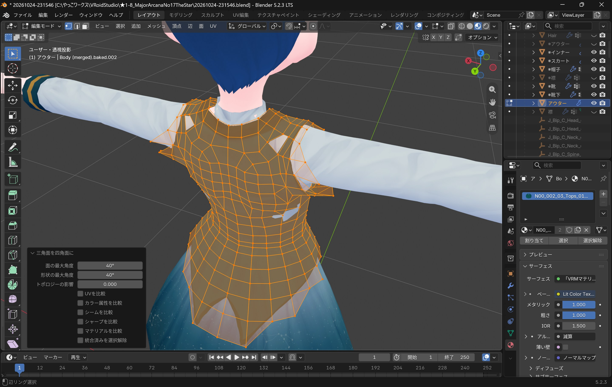
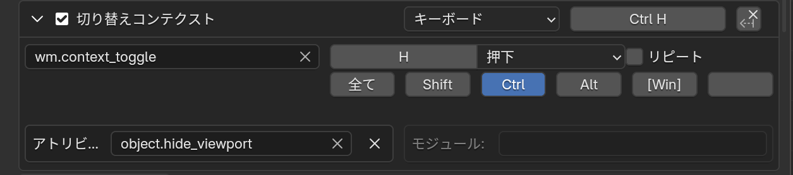
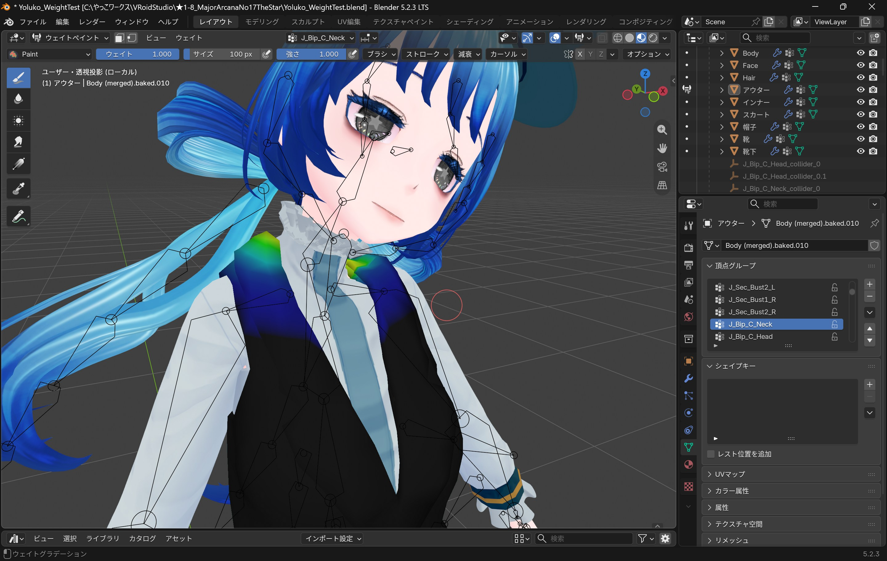
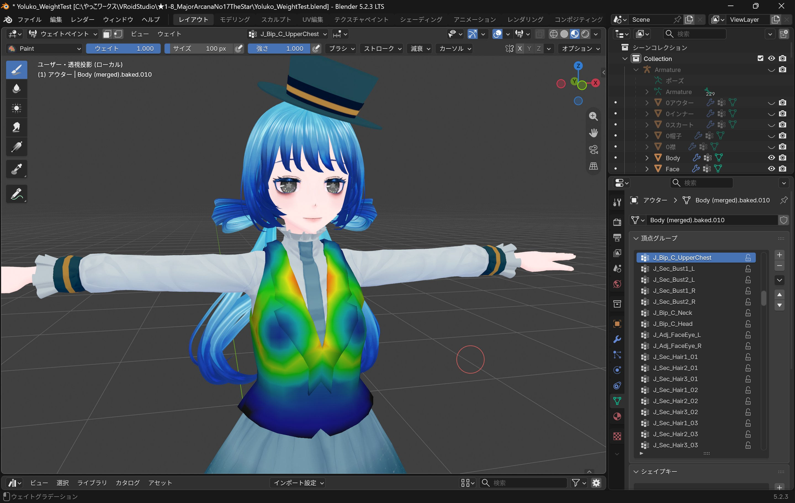
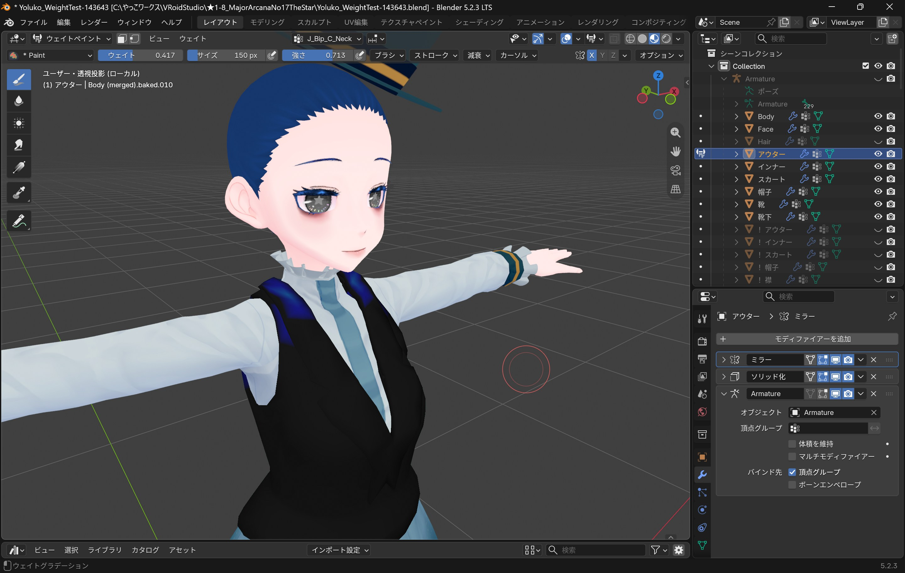
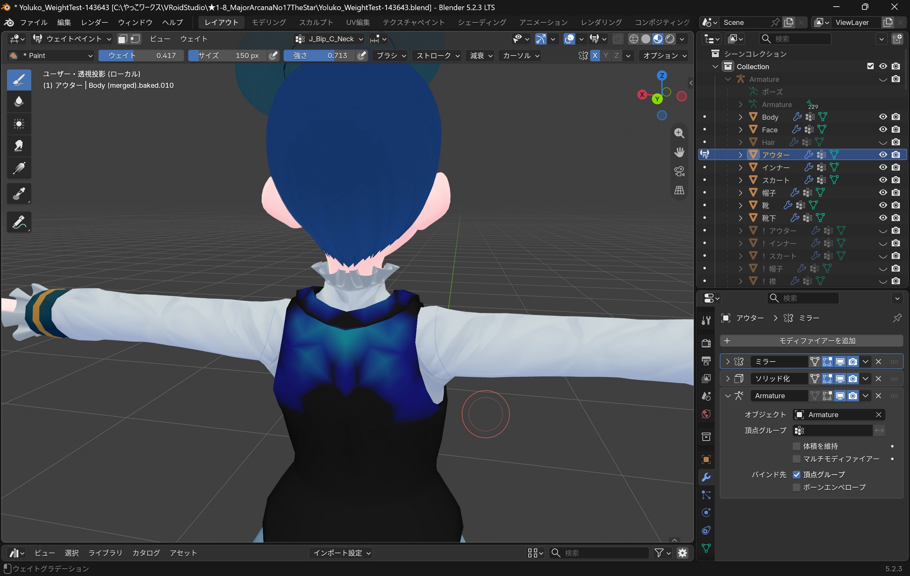
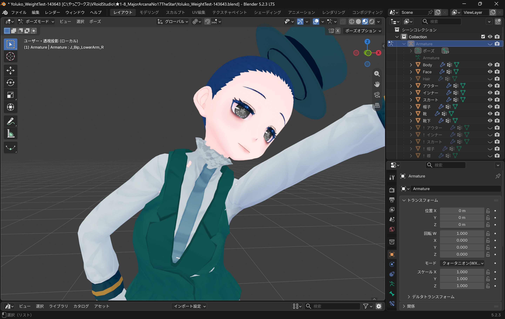
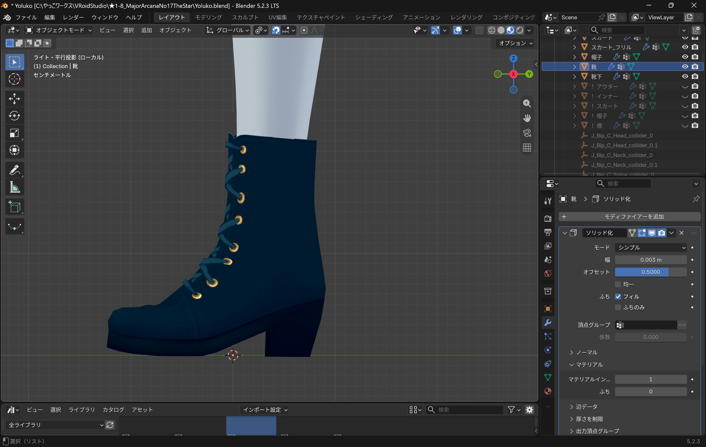
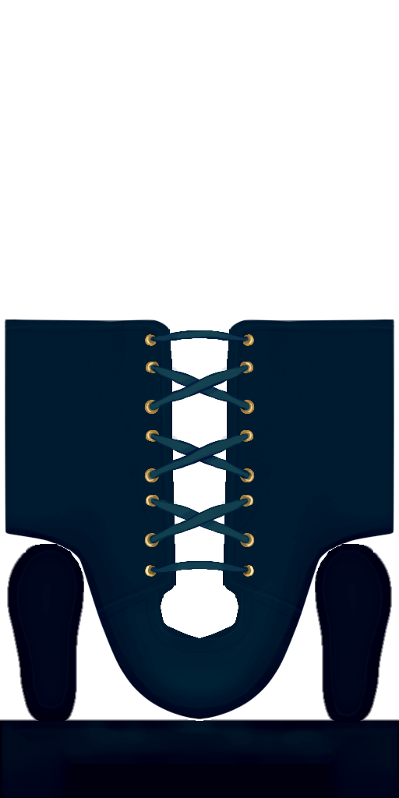
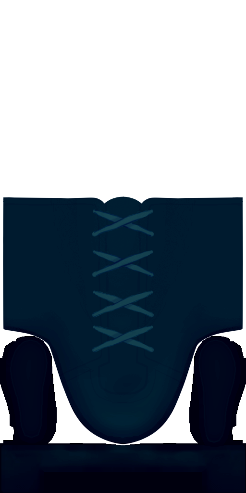

import { Steps } from "@astrojs/starlight/components";

## 三角面を四角面にしたら穴が開く問題


「Alt+J」で「三角面を四角面に」すると<br />
辺や面をループ選択できるようになって大変便利ですが<br />
たまに予期せぬ穴が開いてしまうことがあります<br />

<br />
これは「形状の最大角度」を低い値に設定することで回避できます

<div style={{ display: "flex", width: "100%", gap: "0.8rem" }}>
  <p style={{ flex: 1 }}>
    
  </p>
  <p style={{ flex: 1 }}>
    
  </p>
</div>
<p style={{ textAlign: "center", fontSize: "0.8rem" }}>
  {"Blenderよ,変なところにせくしーな穴を開けないで"}
</p>

他の設定値もいじってみましたが変化はなし…何が変わるのかはよくわからずじまい🤤

## ビューポート表示トグルのキー割り当て
アウトライナーの目玉アイコンをクリックしたときの動作を<br />
「Ctrl+H」に割り当ててみました<br />
<br />
<Steps>
1. プリファレンスのキーマップを開く
2. 「3Dビュー」 ＞ 「オブジェクトモード」 ＞ 「オブジェクトモード（グローバル）」と進む
3. 一番下の「新しく追加」を押し,以下の情報を入力

    
    ```markdown
    - 識別子： `wm.context_toggle`
    - アトリビュート： `object.hide_viewport`
    - 任意のキーボードショートカット（今回はCtrl+H）
    ```

4. 元々あるショートカットキーを削除するため以下の手順を行う
    ```markdown
    1. キーマップの「名前」で「コレクション」と入力
    2. 「コレクションを非表示」を探す
    3. 横にある「Ｘ」ボタンを押す
    ```
</Steps>

## ウエイトペイント

### 塗れない？！ なんで？！
ミラーモディファイアを適用している場合は<br />
ミラーされた側を塗っても何の反応もありません<br />
<br />
一旦モディファイアのビューポート表示を切って<br />
自分が塗ろうとしている面が実在するかどうかを確認しましょう

### ウエイトペイント：ベスト
これはベストのウエイトペイント画面ですが<br />
`J_Bip_C_Neck` が襟元・肩付近に影響していることが確認できます<br />
そして `J_Bip_C_UpperChest` にも同じ領域への影響がありますね
<div style={{ display: 'flex', width: '100%', gap: "0.8rem"  }}>
  <p style={{ flex: '1' }}>
    
  </p>
  <p style={{ flex: '1' }}>
    
  </p>
</div>
`J_Bip_C_Neck` のウエイトを以下のように塗りなおしてみます
<div style={{ display: 'flex', width: '100%', gap: "0.8rem" }}>
  <p style={{ flex: '1' }}>
    
  </p>
  <p style={{ flex: '1' }}>
    
  </p>
</div>
そしてポーズをとらせると…
<div style={{ display: 'flex', width: '100%', gap: "0.8rem" }}>
  <p style={{ flex: '1' }}>
    
  </p>
  <p style={{ flex: '1' }}>
    
  </p>
</div>
<p style={{ textAlign: 'center', fontSize: '0.8rem',margin:'0.6rem 0' }}>☄️「なんでやね～ん！ ……なんちゃって！ ……えへへ……」</p>
`J_Bip_C_Neck` のウエイトを減らすことでベストの襟元の変形が改善しました！

## 靴の立体感をお手軽に出す
靴は,表面になる部分と後側に来る部分をあらかじめテクスチャ側で分けておき<br />
ソリッド化モディファイアを適用して「マテリアルオフセット」機能で<br />
それぞれ別のテクスチャを表示させることで,疑似的に立体感を出しています
<div style={{ display: 'flex', width: '100%', gap: '0.8rem' }}>
  <p style={{ flex: '1' }}>
    
  </p>
  <p style={{ flex: '1' }}>
    
  </p>
</div>
<p style={{ textAlign: 'center', fontSize: '0.8rem', margin:'0.6rem 0' }}>モディファイア 適用前 ＞ 適用後</p>
<div style={{ display: 'flex', width: '100%', gap: '0.8rem' }}>
  <p style={{ flex: '1' }}>
    
  </p>
  <p style={{ flex: '1' }}>
    
  </p>
</div>
<p style={{ textAlign: 'center', fontSize: '0.8rem', margin:'0.6rem 0' }}>靴底はどちらも忘れずに（最初片方だけ忘れてたからネ…）</p>